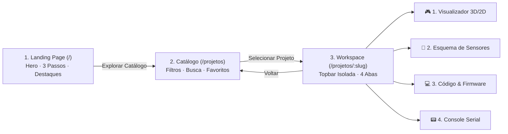

# 🌐 VersIOT — Central Interativa de Projetos IoT & Telemetria Visual

<p align="center">
  <strong>Hardware Real, Simulação Virtual</strong><br />
  Plataforma educacional open source que conecta microcontroladores diretamente ao navegador via Web Serial API, com simulações 3D fotorrealistas (Three.js), esquemas de ligação didáticos, firmwares C++ e terminal serial de debug.
</p>

<p align="center">
  <a href="https://versiot.dorneles.dev/"><strong>versiot.dorneles.dev</strong></a> ·
  <a href="#-fluxo-de-navegação">Fluxo de Navegação</a> ·
  <a href="#-catálogo-de-projetos-integrados">Projetos</a> ·
  <a href="#-como-executar-localmente">Como Rodar</a> ·
  <a href="./docs/ADD_A_PROJECT.md">Adicionar Projeto</a> ·
  <a href="./LICENSE">Licença Apache-2.0</a>
</p>

---

## 🎯 Arquitetura & Fluxo de Navegação

Inspirado na experiência de usuário intuitiva do Tinkercad, o **VersIOT** adota um funil de navegação em 3 camadas que guia o usuário do primeiro contato ao desenvolvimento avançado de hardware:



### 1. 🌟 Landing Page (`/`) — A Vitrine
- **Hero Section:** Apresentação clara de valor (*"Hardware Real, Simulação Virtual"*), CTAs rápidos e mockup visual animado da telemetria.
- **Como Funciona (3 Passos):** Ilustrações minimalistas do fluxo:
  1. *Conecte o cabo USB* (W3C Web Serial sem drivers adicionais);
  2. *Carregue o firmware* (C++ pronto para Arduino IDE / PlatformIO);
  3. *Interaja em 3D* (60-144 FPS com Three.js e WebGL).
- **Projetos em Destaque:** Cards visuais dos principais projetos para experimentação imediata.

### 2. 🗂️ Catálogo de Projetos (`/projetos`) — O Dashboard
- Layout em grid limpo com pesquisa textual instantânea.
- **Filtros Laterais Rápidos:**
  - **Nível de Dificuldade:** Iniciante, Intermediário, Avançado;
  - **Microcontrolador:** ESP32, Arduino (Uno/Nano), Raspberry Pi Pico;
  - **Categoria:** Aeroespacial, Robótica & Radar, Ambiente & Clima, Domótica & Automação, Saúde & Biometria.
- **Favoritos:** Salvos localmente no navegador via `localStorage`.

### 3. 🛸 Workspace do Projeto (`/projetos/:slug`) — A Imersão
Interface focada em produtividade e maximização de tela:
- **Topbar Utilitária:** Logo VersIOT, botão de retorno ao catálogo, seletor de projeto atual, status de conexão (*Desconectado / Conectado / Simulando*), botões de **Conectar USB** e **Simular**, e alternador de tema Claro/Escuro.
- **Header do Projeto:** Ícone, descrição resumida e badges informativos.
- **Sistema de 4 Abas:**
  - **Aba 1 — Visualizador Interativo:** Renderiza o Canvas 3D (Three.js/Fiber) ou gráficos 2D reativos em tempo real ao fluxo de dados.
  - **Aba 2 — Esquema de Sensores:** Diagrama esquemático em SVG com código de cores de jumpers, tabela pino a pino e avisos elétricos.
  - **Aba 3 — Código & Firmware:** Editor com destaque de sintaxe Prism C++, botão de cópia com um clique e download do arquivo `.ino`.
  - **Aba 4 — Console Serial:** Terminal interativo com auto-scroll, pausa de stream, seletor de baud rate (9600 a 115200 bps) e envio de comandos manuais.

---

## 🎯 Catálogo de Projetos IoT Integrados

```
VersIOT (Laboratório de Telemetria)
├── ✈️ FlightScope   (Aeroespacial: Caça delta 3D, Cockpit 1:1, HUD Militar, MPU-6050 + HC-SR04)
├── 📡 SonarScope    (Robótica: Radar Militar 180° CRT de fósforo, Servo SG90 + HC-SR04)
├── 🌱 BioScope      (Ambiente: Estufa/Terrário com chuva, sol e planta viva, DHT22 + LDR + Solo)
├── 🏠 HomeScope     (Domótica: Maquete Isométrica 3D com Presença PIR e Alarme de Gás MQ-2)
└── 🫀 PulseScope    (Saúde: Monitor Cyberpunk, Coração 3D pulsante, ECG Neon e SpO2)
```

---

## 🛠️ Stack Tecnológica

- **Frontend Core:** React 19, TypeScript (modo estrito), Vite 6, React Router v7
- **Renderização Gráfica & 3D:** Three.js, `@react-three/fiber`, `@react-three/drei`, Canvas API 2D
- **Gráficos & Métricas:** Recharts
- **Estilização:** CSS Modules puros (`.module.css`) com tokens Oklch nativos — **Zero Tailwind / Zero classes utilitárias**
- **Componentes de Acessibilidade:** Radix UI Primitives (Tabs, DropdownMenu, Tooltip, Dialog, Select, Checkbox)
- **Internacionalização:** `i18next` + `react-i18next` (estrutura modular preparada para múltiplos idiomas)
- **Hardware Protocol:** Web Serial API (W3C standard), Arduino C++
- **Testes & Qualidade:** Vitest, Testing Library, JSDOM
- **Servidor de Produção:** Nginx 1.27 Alpine + Docker

---

## 🚀 Como Executar Localmente

### Pré-requisitos
- **Node.js** (v20 ou superior) e **npm**
- Navegador com suporte à Web Serial API (**Google Chrome**, **Microsoft Edge** ou **Opera**)

### 1. Clonar e Instalar
```bash
git clone git@github.com:dorneles-laboratory/versiot.git
cd versiot
npm install
```

### 2. Iniciar Servidor de Desenvolvimento
```bash
npm run dev
```
Acesse `http://localhost:5190/` no seu navegador.

### 3. Executar Testes Unitários
```bash
npm run test
```

### 4. Build de Produção
```bash
npm run build
npm run preview
```

---

## 🐳 Executando com Docker

```bash
docker compose -f docker-compose.prod.yml up -d --build
```

---

## 🤝 Como Contribuir

Contribuições são muito bem-vindas!
- Consulte o [Guia de Contribuição (`CONTRIBUTING.md`)](./CONTRIBUTING.md)
- Para adicionar novos projetos IoT, siga o passo a passo em [`docs/ADD_A_PROJECT.md`](./docs/ADD_A_PROJECT.md)
- Para traduzir ou adicionar novos idiomas, consulte [`docs/TRANSLATING.md`](./docs/TRANSLATING.md)

---

## 📄 Licença

Distribuído sob a licença **Apache-2.0**. Consulte [`LICENSE`](./LICENSE) para mais informações.

Desenvolvido por **Fernando Dorneles da Silva**  
Laboratório Dorneles (Dorneles Laboratory) / Universidade Federal de Santa Maria (UFSM)  
Website: [https://dorneles.dev](https://dorneles.dev)
